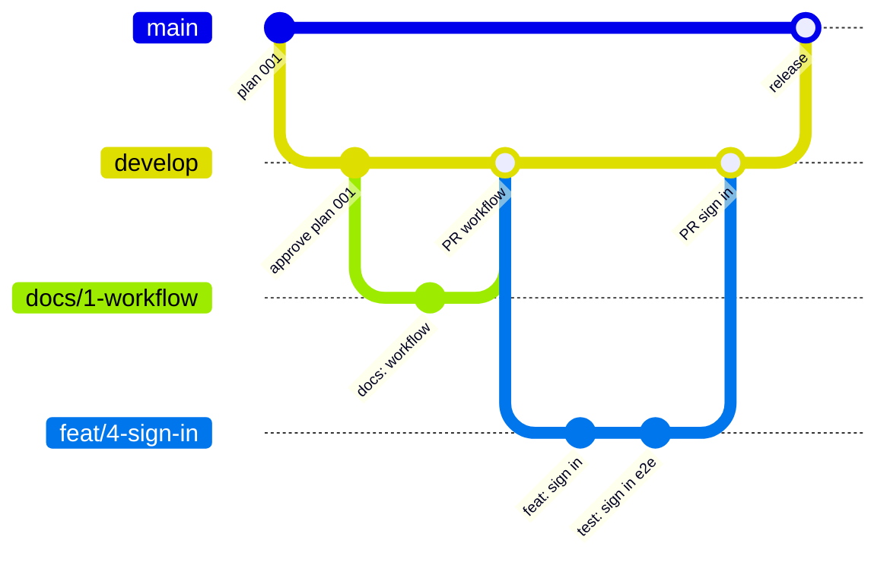
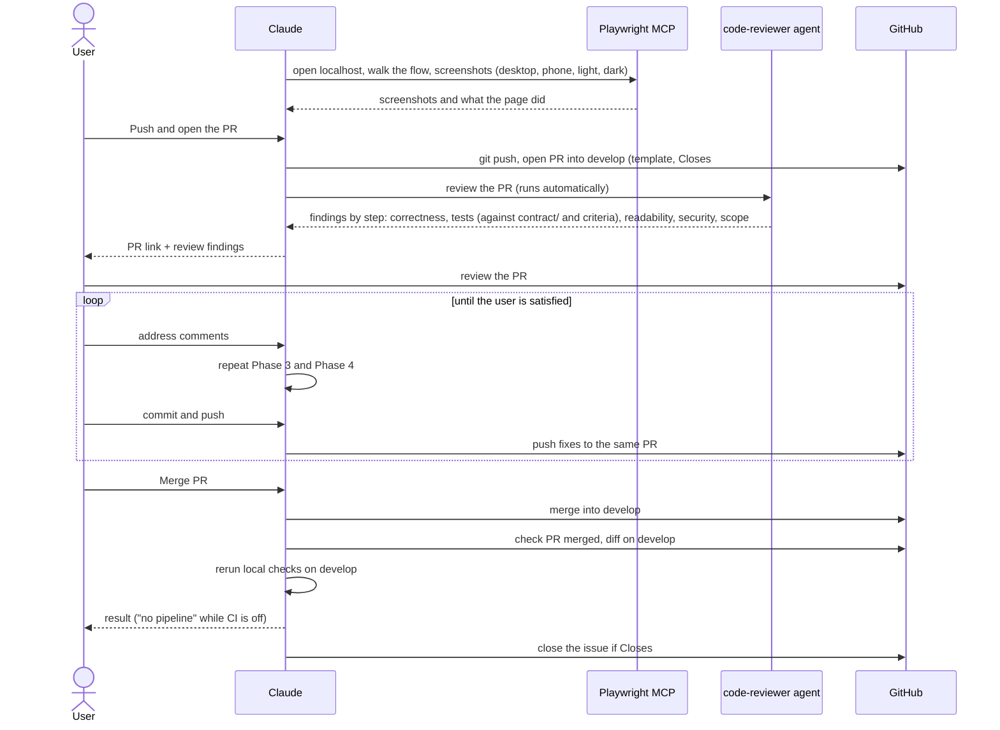
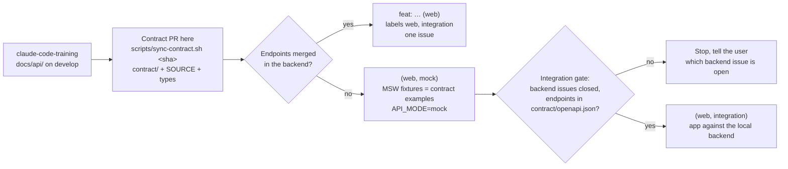
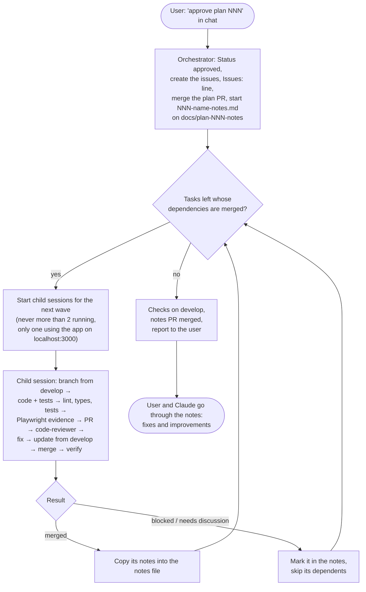

# Development workflow

These diagrams picture the workflow in [`CLAUDE.md`](../CLAUDE.md#workflow). If a diagram and `CLAUDE.md` disagree, `CLAUDE.md` wins; fix the diagram.

## 1. Phases and gates

Each change goes through phases 1 to 6 in order, starting from an approved plan file (`docs/plans/`). Only the user can approve a plan, on GitHub or by saying "approve plan NNN" in chat. Approving a plan in chat lets Claude merge the plan PR. Approving a step-by-step plan is not authorizing the merge of its task PRs; approving an autonomous plan is (see section 6). Diamonds are gates. A gate that needs the user stops the work until they answer.

Phase 0 (project foundation: architecture, stack, layout, Claude rules, Playwright MCP server, tooling) is not a step of each change. It is done once and revisited only when the foundation itself changes, through its own issue.

```mermaid
flowchart TD
    START(["New change"]) --> TRIV{"Trivial?<br/>(typo, one-line fix)"}
    TRIV -- yes --> P3
    TRIV -- no --> P1["Phase 1: Classify the ticket"]
    P1 --> G1{"Required evidence<br/>present?"}
    G1 -- no --> ASK1["Ask the user for it"] --> G1
    G1 -- yes --> PLAN["Write docs/plans/NNN-name.md<br/>Status: draft<br/>(open questions, approach, risks,<br/>verification, issues to create)"]
    PLAN --> PMR["Push docs/plan-NNN-name,<br/>open the plan PR"]
    PMR --> APPR{"User approves:<br/>Status: approved on GitHub,<br/>or 'approve plan NNN' in chat?"}
    APPR -- "no / edits needed" --> PLAN
    APPR -- "yes in chat,<br/>Run mode: autonomous" --> RUN(["Autonomous plan run:<br/>see section 6"])
    APPR -- "yes, step by step,<br/>or autonomous approved on GitHub<br/>(chat approval: Claude merges the plan PR)" --> ISSUE["Create the issues exactly as the plan lists them<br/>(Plan: link in each),<br/>branch type/id-name from develop"]
    ISSUE --> P2["Phase 2: Impact analysis,<br/>check the contract in contract/"]
    P2 --> G2{"Needs something the<br/>approved plan or the contract<br/>does not cover?"}
    G2 -- yes --> PLAN
    G2 -- no --> P3
    P3["Phase 3: Small steps<br/>code → tests → lint → type check<br/>+ Playwright MCP: walk the flow, screenshots<br/>Stop hook reruns the checks"] --> G4
    G4{"Phase 4 gate:<br/>criteria met, lint, types and tests pass,<br/>e2e passes (integration work only),<br/>security ok, diff in scope,<br/>evidence with screenshots drafted?"}
    G4 -- no --> P3
    G4 -- yes --> P5["Phase 5, when the user asks:<br/>first time: push, open PR into develop,<br/>Closes #id, Plan: link, deviations,<br/>Playwright screenshots in the description<br/>after review: push fixes to the same PR"]
    P5 --> REV["code-reviewer runs automatically<br/>when the PR is opened"]
    REV --> UREV{"User review:<br/>changes needed?"}
    UREV -- yes --> P3
    UREV -- no --> MERGE{"User authorizes<br/>the merge of this PR?"}
    MERGE -- not yet --> UREV
    MERGE -- yes --> P6["Phase 6: Merge, verify develop,<br/>close the issue"]
```

## 2. Branching

`develop` collects finished work through pull requests. `main` only receives merges from `develop` for a release. Nobody pushes directly to either.

## 3. Pull request and review

## 4. Contract and the backend

The API contract lives in `claude-code-training`. This repo copies it into `contract/` at a pinned commit. A web feature whose endpoints are not merged yet is split into a `(web, mock)` and a `(web, integration)` issue (see "Web tasks: mock and integration" in [`CLAUDE.md`](../CLAUDE.md#phase-1-plan-approval-and-issues)).

## 5. Permissions

The permission rules (what Claude may write, commit, push, create or merge, and that only the user approves a plan) stay as the table in [`CLAUDE.md`](../CLAUDE.md#git-and-github-permissions). They are not drawn as a diagram, so there is only one place to change them.

## 6. Autonomous plan run

A plan with `Run mode: autonomous` needs one approval, in chat. The session where the user approved is the orchestrator; each task runs in its own child session, at most 2 at once. Nothing stops to ask the user: doubts go into the notes file. The rules are in [`CLAUDE.md`](../CLAUDE.md#autonomous-plan-runs), the steps in the [`run-plan`](../.claude/skills/run-plan/SKILL.md) skill.

